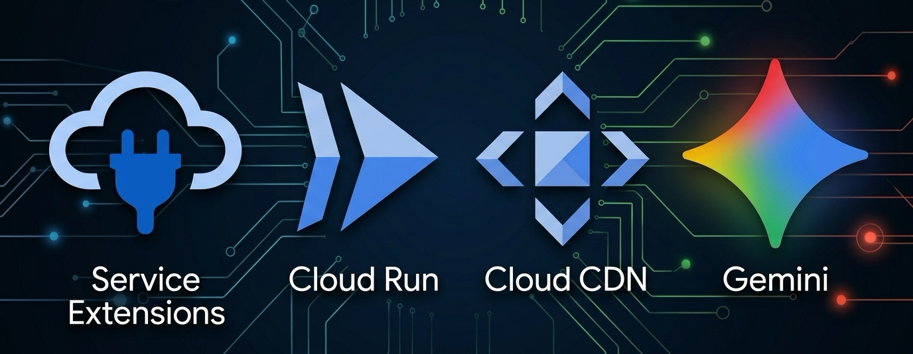
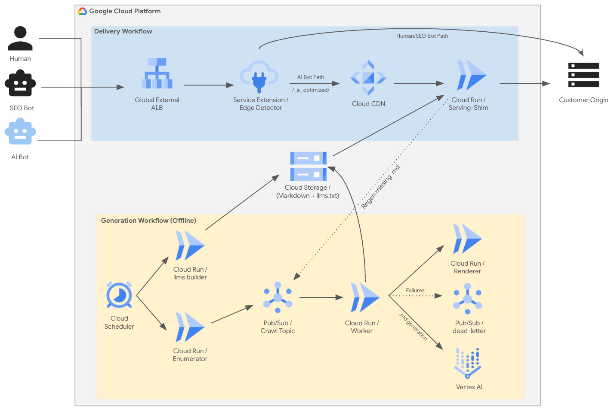

# Google Cloud CDN - AI Content Optimizer

**Give AI crawlers a clean, fast version of your website, automatically, without touching the
site your human visitors see.**

The bots behind Gemini, ChatGPT, Perplexity, and other AI assistants can read websites badly. Most modern
sites are JavaScript-heavy, cluttered, and slow, so an AI crawler often gets a thin or empty view of
your content, which means your pages are underrepresented in AI answers.

AI Content Optimizer fixes this. It runs entirely inside **your own Google Cloud project**, on top of
your existing load balancer. On a schedule it crawls your site, turns every page into clean,
LLM-friendly Markdown, generates standard **`llms.txt` and `llms-full.txt`** site indexes, and stores
everything in Google Cloud Storage. At your load balancer, it detects AI crawlers and serves *them*
the optimized content, while every human visitor and search engine gets your normal site, completely
unchanged. It also serves `/llms.txt` and `/llms-full.txt` directly at your site root so AI agents
can instantly discover and ingest your entire knowledge base.

You deploy it with Terraform. You never build anything: the container images are published and pulled
automatically.

Designed to work with **any** kind of site: retail, news, financial, blogs/WordPress, marketing, docs, FAQ, plain
HTML.

## 🚀 Step-by-Step Integration Guide

Ready to deploy on your site? Follow our comprehensive **[Step-by-Step Integration Guide](docs/INTEGRATION_GUIDE.md)** for copy-paste Terraform configuration, least-privilege IAM setup, and end-to-end verification commands.

---

## How it works

Two things happen, and they're independent:

- The **offline plane** does all the slow, expensive, AI-heavy work ahead of time. If it ever stops,
  your site is unaffected and the last good content keeps serving. On every scheduled run, the worker
  crawls your site, converts each page to optimized Markdown, and runs an indexer job that creates both
  an `llms.txt` table of contents and an `llms-full.txt` combined corpus.
- The **serving plane** is trivial and fast: it just hands back a file that already exists. The
  decision "is this an AI crawler?" happens at the edge, in a lightweight extension attached to your
  load balancer.
- **Standard `/llms.txt` and `/llms-full.txt` serving**: Requests for `/llms.txt` or `/llms-full.txt`
  are automatically routed to Cloud CDN and served from Cloud Storage, allowing any
  agent or research tool following the `llms.txt` standard to discover your site's complete corpus at once.

The split between AI crawlers and humans is made **by URL path**, not by caching different content
under the same URL, so there's no risk of a human ever being served the wrong version, and no cache
poisoning.

## What you get

- **AI crawlers get clean content; humans get your real site.** Two audiences, one URL, no cloaking of
  search engines (Googlebot, Applebot, etc. are deliberately *not* rerouted).
- **Gemini 3.5 Flash Powered Extraction.** The offline worker uses a hybrid cascade engine: structured JSON-LD data is extracted deterministically when present, and complex pages escalate to **Gemini 3.5 Flash** (via Vertex AI) for accurate Markdown conversion.
- **Zero request-time cost.** Content is generated offline and served from Cloud CDN. No model is ever
  called on the live path, so it adds no latency to anyone.
- **Self-healing.** If an AI crawler asks for a page that hasn't been generated yet, it's served from
  your origin immediately and queued for generation in the background.
- **Standard `/llms.txt` and `/llms-full.txt` site discovery.** Produced automatically on every offline run
  and served directly at `/llms.txt` and `/llms-full.txt`. AI crawlers and agents looking for `llms.txt`
  get a clean, structured table of contents and full Markdown bundle out of the box.
- **Least-privilege by default.** Every component runs under its own service account with only the
  access it needs. See [Permissions & security](docs/INTEGRATION_GUIDE.md#permissions--security).
- **It never modifies your load balancer.** Everything the tool creates lives under a name prefix you
  control, and the two changes it makes to your load balancer are additive commands *you* run and can
  undo.

## What you need

This is an integrated solution built on Google Cloud's edge stack. To deploy it you need:

- A **Google Cloud project** with billing enabled.
- An **existing global external Application Load Balancer** serving your site. The tool attaches to it.
  (An Application Load Balancer is Google Cloud's HTTP(S) load balancer.) You don't need Cloud CDN on it
  already (although we encourage it!): the tool enables Cloud CDN on the optimized-content backend it adds, and leaves your own
  backends untouched.
- The **Service Extensions** feature available on that load balancer. This is what lets the tool run
  its AI-crawler detector at the edge.
- **`gcloud`** installed and authenticated with Application Default Credentials
  (`gcloud auth application-default login`).
- **Terraform** `>= 1.9`.

Don't have a global external load balancer yet? That's the foundation this solution routes through.
Set one up in front of your site first, then come back.

## Get started

For complete, step-by-step setup and deployment instructions, see the **[Integration Guide](docs/INTEGRATION_GUIDE.md)**.

Overview of steps:
1. Point the Terraform module at your project and site (`terraform/examples/brownfield`).
2. `terraform apply` deploys the generation pipeline and the AI-crawler serving backend.
3. Run one command to generate your content.
4. Apply two copy-paste commands to your load balancer to start routing AI crawlers.
5. Verify that an AI-crawler request gets Markdown and a browser gets your normal page.

## Repository layout

| Path | What it is |
|---|---|
| [`terraform/modules/core/`](terraform/modules/core/) | The module you deploy: all the Google Cloud resources it creates |
| [`terraform/examples/brownfield/`](terraform/examples/brownfield/) | A ready-to-copy example that wires the module to an existing site |
| [`docs/INTEGRATION_GUIDE.md`](docs/INTEGRATION_GUIDE.md) | Step-by-step deployment guide (includes a permissions & security reference) |
| `services/` | Source for the published container images (worker, renderer, serving-shim, edge plugin) |
